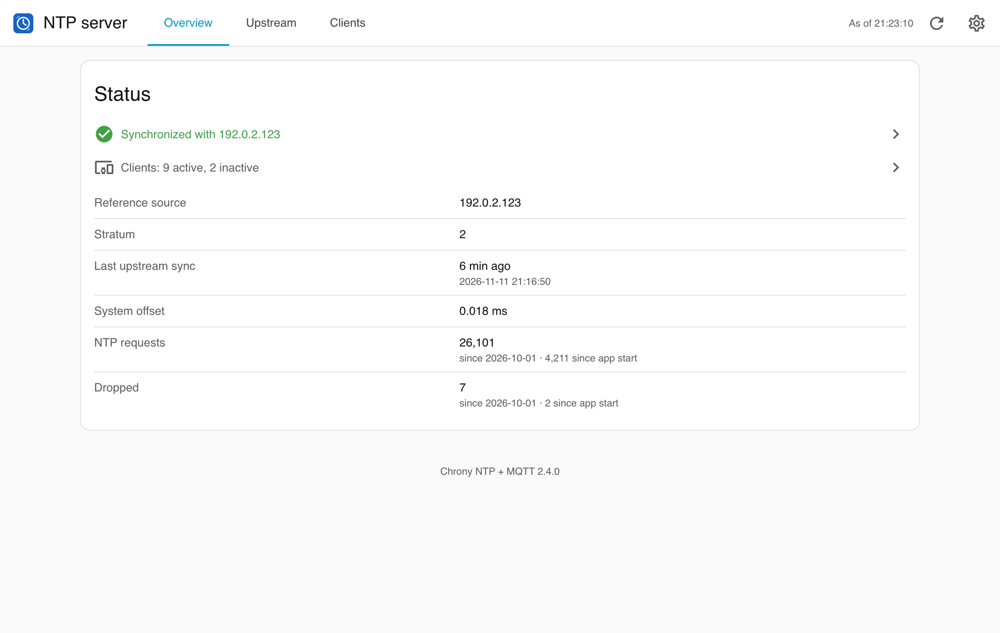
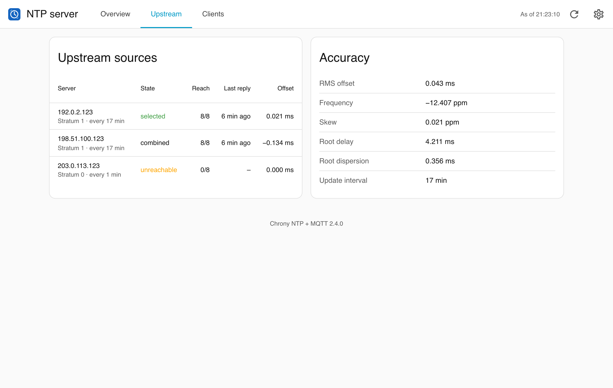
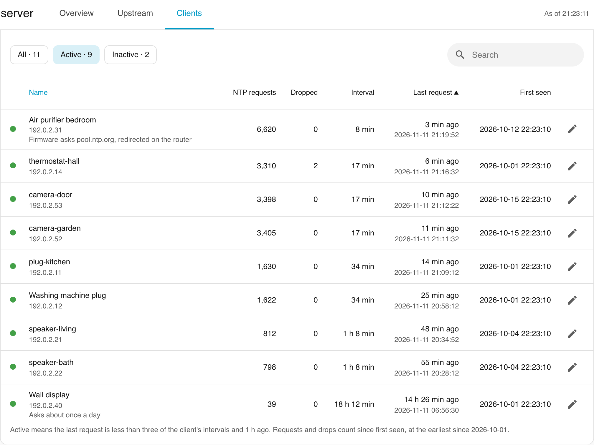
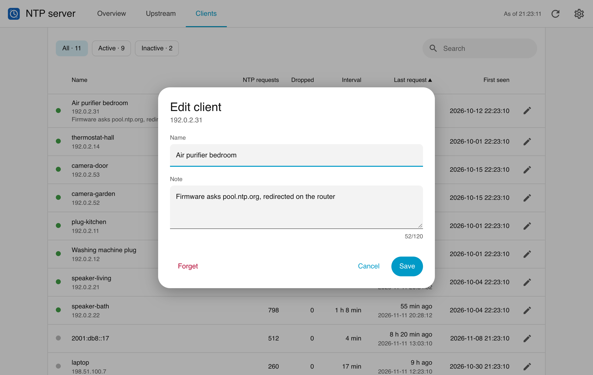
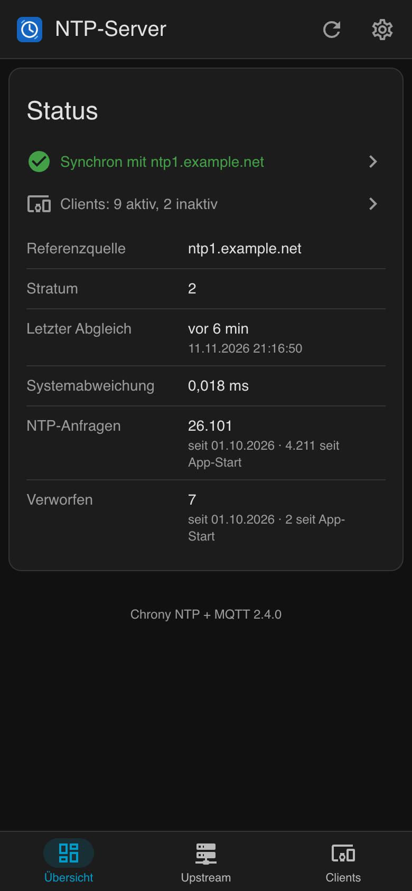
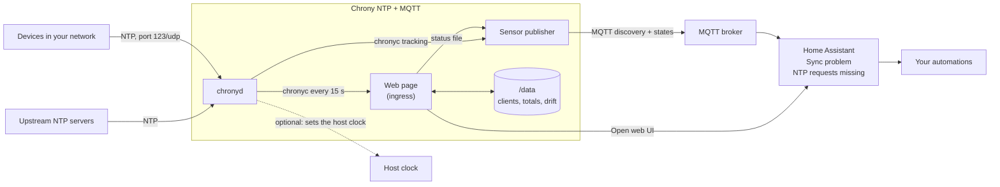

# Chrony NTP + MQTT app for Home Assistant

[](LICENSE)


A Home Assistant app that runs [chrony](https://chrony-project.org/) as a local NTP server for your network. Its page in Home Assistant shows the sync status, the upstream sources and every client with the time of its last request, a name and a note. Two problem sensors through MQTT discovery tell Home Assistant when the server loses its upstream source or no client asks any more.

Requires Home Assistant 2026.11 or later.

## Screenshots

The page looks like Home Assistant's own settings, follows the theme in use and speaks the language of Home Assistant's interface (German or English). The data on these pictures is made up.











## Overview



The [documentation](chrony_ntp/DOCS.md) covers the options, the page, the sensors, example automations and troubleshooting. Changes are listed in the [changelog](chrony_ntp/CHANGELOG.md).

## Installation

1. Add the repository to your Home Assistant instance:

   [](https://my.home-assistant.io/redirect/supervisor_add_addon_repository/?repository_url=https%3A%2F%2Fgithub.com%2Fn-schilling%2Fha-app-chrony-mqtt)

   Or add it manually: **Settings → Apps → Install app → ⋮ → Repositories**, then paste:

   ```text
   https://github.com/n-schilling/ha-app-chrony-mqtt
   ```

2. Install **Chrony NTP + MQTT**, review the options and start it.

## Development

The web page is a single Python module on the standard library, [`chrony_web.py`](chrony_ntp/rootfs/usr/local/lib/chrony_web.py); the sensor publisher and the setup of chrony are s6 services in [`chrony_ntp/rootfs/etc/s6-overlay/s6-rc.d`](chrony_ntp/rootfs/etc/s6-overlay/s6-rc.d). The page's look comes from the stylesheet shared by these apps, [`ha.css`](chrony_ntp/rootfs/usr/local/share/ha-app/ha.css), and its language from the script shared by them, [`ha-lang.js`](chrony_ntp/rootfs/usr/local/share/ha-app/ha-lang.js); both stay identical in every app. The image installs only Alpine packages, no Python packages.

```bash
scripts/check.sh
```

`scripts/check.sh` runs what CI runs: the changelog check, shellcheck, ruff, the image build, the tests inside the built image, the Page check, and the tests against a Mosquitto broker in Docker (`--no-broker` skips them). It needs Docker and [uv](https://docs.astral.sh/uv/); shellcheck and ruff come from `PATH`, else from Docker and uv.

The Page check, `scripts/screenshots.py`, starts the built image with made-up data next to a stand-in for Home Assistant's ingress proxy (at its address 172.30.32.2, path prefix `/api/hassio_ingress/<token>/`, the page in a frame) and opens it in headless Chromium, light, dark and at phone width, in English and German. It checks the header every app page shares (name; stamp "As of HH:MM:SS", refresh, and the settings gear, which opens the app's configuration outside the frame), the version line, that the page takes Home Assistant's language over the browser's (a stand-in for its frontend in German, English and French around the frame, reloading once), and that there are no console errors or Content Security Policy violations. Without `--check` it also takes the screenshots in `docs/screenshots`:

```bash
uv run --with playwright==1.58.0 python scripts/screenshots.py --build
```

Releases: work on `dev`, raise `version` in `chrony_ntp/config.yaml` and add its section to the changelog. CI runs on `dev` (amd64 and aarch64 each on a runner of its own kind); once it is green, push that commit to `main`. CI does not run again there: the release workflow checks that CI passed for the commit, then tags the version and publishes the release with that section.

## Support

Questions, bugs and ideas: [open an issue](https://github.com/n-schilling/ha-app-chrony-mqtt/issues/new/choose) in this repository. Security problems: see [SECURITY.md](SECURITY.md).

## License

[Apache License 2.0](LICENSE). Based on the [Chrony app](https://github.com/hassio-addons/app-chrony) of the Home Assistant Community Apps, MIT License; see [NOTICE](NOTICE).
