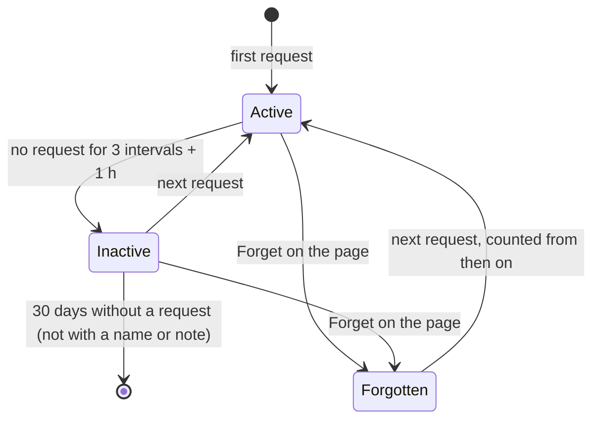
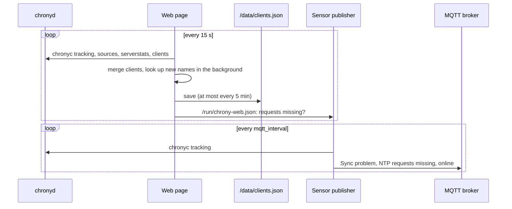

# Chrony NTP + MQTT

Runs chrony as an NTP server on port 123/udp, so devices in your network can take their time from Home Assistant instead of the internet. A page in Home Assistant shows the server's state and every client; two problem sensors, announced through MQTT discovery, tell Home Assistant when something is wrong.

## Requirements

- Home Assistant 2026.11 or later
- An MQTT broker known to the Supervisor, e.g. the Mosquitto broker app with the MQTT integration
- Port 123/udp free on the host
- Devices that take their time from it: give them the Home Assistant host as NTP server (e.g. by DHCP option 42), or redirect NTP from a network segment to it on your router. To check it from a computer in your network: `sntp <home-assistant-host>`

The app asks for the `SYS_TIME` capability, so chrony may set the host clock when `set_system_clock` is on, and for port 123/udp on the host. Only the setup at the start runs as root: chronyd and the web page run as chrony's own user, the sensor publisher as a user of its own that alone can read the broker's password. An AppArmor profile allows only the capabilities, networks, programs and paths the app uses.

## Options

| Option | Default | Meaning |
|---|---|---|
| `mode` | `pool` | `pool`: one pool name that resolves to several servers; `server`: a list of servers |
| `ntp_pool` | `pool.ntp.org` | Pool used in pool mode |
| `ntp_server` | `0–2.pool.ntp.org` | Servers used in server mode |
| `set_system_clock` | `true` | Let chrony adjust the host clock; off makes chrony only serve time |
| `allowed_networks` | | Networks that may take time from this server, e.g. `192.168.1.0/24` or `fd00::/8`. Empty serves the private networks (`10.0.0.0/8`, `172.16.0.0/12`, `192.168.0.0/16`, `fc00::/7`, `fe80::/10`); `0.0.0.0/0` and `::/0` serve every client that reaches port 123 of the host |
| `serve_when_offline` | `false` | Keep serving the host clock at stratum 10 when no upstream server is reachable, so clients stay in step with each other; the *Sync problem* sensor turns on meanwhile |
| `mqtt_interval` | `300` | Seconds between two sensor updates |
| `discovery_prefix` | `homeassistant` | MQTT discovery prefix |
| `log_level` | `info` | How much the app writes to its log: `debug`, `info`, `warning` or `error` |

chrony keeps the frequency error of the host clock in the app's data folder, so it is accurate again soon after a restart. It answers each client at most about once in two seconds on average; requests beyond that count as dropped.

## Web page

**Open web UI** on the app's page opens it; **Show in sidebar** adds **NTP Server** to the sidebar (administrators only). The page follows your Home Assistant theme and updates itself every 30 seconds; the refresh button in the header reads chrony at once, the time next to it shows how current the data is, and the gear opens the app's configuration. The app's name and version are at the bottom of the page.

The page speaks the language of your Home Assistant interface (your profile's language): German, else English. It keeps that language in a cookie for this page only; after you change the language in your profile, the page follows the next time you open it, reloading once.

- **Status**: synchronized or not, whether clients still ask, reference source, stratum, last upstream sync, system offset, and the NTP requests and dropped requests in total and since the app started
- **Upstream sources**: each server chrony uses, its state (selected, combined, unreachable, …), how many of the last 8 polls it answered, its last reply and offset
- **Accuracy**: RMS offset, frequency, skew, root delay and dispersion, update interval
- **Clients**: every device that took time from the server, with its name, address, note, requests and drops since it was first seen, request interval, time of its last request and when the app first saw it; sortable by every column, filterable by active/inactive and searchable, also by name and note

A client is **active** while its last request is less than three of its own request intervals and an hour ago. A plug that asks every 34 minutes turns inactive after about 2 h 40 min without a request, a display that asks once a day after two to five days, as chrony rounds its interval to a power of two. Before chrony knows a client's interval, i.e. after its first request, 17 minutes are assumed.



The pencil at the end of a row edits the client:

- **Name**: shown instead of the name from reverse DNS, up to 40 characters; empty shows the reverse DNS name again
- **Note**: plain text, up to 120 characters, shown under the address and found by the search
- **Forget**: removes the client from the list. It comes back with its next request, counted from then on.

chrony forgets its counters and clients when it restarts. The page therefore keeps the request totals of the server and of each client, when it first and last saw each client, its request interval, name and note in the app's data folder, so a client that asks only once a day still shows up after an app update with its last request. The list keeps at most 1000 clients: beyond that, addresses that asked only once go first, then those away longest; clients with a name or note stay.



## Sensors

Device **Chrony NTP Server**, with the two things worth an automation; everything else is on the web page:

| Sensor | Meaning |
|---|---|
| Sync problem | On while unsynchronized (stratum 0 or 16), serving its own clock (`serve_when_offline`) or a leap status other than normal |
| NTP requests missing | On while no client of the last 7 days is active, i.e. none asked within its usual time: the server or the way to it is broken, e.g. a router change broke the NTP redirect. Off while there are no clients yet; a client that has not asked for 7 days no longer counts, so the sensor turns off a week after the last request |

Both turn unavailable when the app stops or its connection to the broker breaks; after a reconnect the app announces the device again and publishes the states at once. *NTP requests missing* is unknown while the web page does not run. The link on the device's page opens the app's page in Home Assistant.

## Example automations

Notify when the server loses its upstream time source for 15 minutes:

```yaml
triggers:
  - trigger: state
    entity_id: binary_sensor.chrony_ntp_server_sync_problem
    to: "on"
    for: "00:15:00"
actions:
  - action: notify.notify
    data:
      message: "The NTP server has no upstream time source."
```

Notify when no device takes its time from the server any more, e.g. after a router change broke the NTP redirect:

```yaml
triggers:
  - trigger: state
    entity_id: binary_sensor.chrony_ntp_server_ntp_requests_missing
    to: "on"
actions:
  - action: notify.notify
    data:
      message: "No device takes its time from the NTP server any more."
```

The entity IDs follow the device name; adjust them if you renamed the device.

## Troubleshooting

- **The app does not start, port 123 is in use.** Another app or service on the host serves NTP. Stop it, or map the app's port to another one on the *Configuration* tab and point your devices there.
- **No clients on the page.** Devices only show up after they asked for the time. Check that they use the Home Assistant host as NTP server, that a redirect on the router points to it, and that their network is a private one or listed in `allowed_networks`.
- **Sync problem stays on.** The host cannot reach the upstream servers. Check outgoing UDP port 123 on your router and the servers in `ntp_pool` / `ntp_server`; the log shows chrony's view.
- **NTP requests missing is on although the server works.** A device you took away was the only client of the last 7 days, or all others are switched off. Forget it on the page (pencil → Forget), or the sensor turns off by itself a week after its last request.
- **The entities are unavailable.** The app is stopped, or it lost its connection to the MQTT broker; the log tells which.
- **The log says the client list could not be read.** The file was damaged, e.g. by a power cut; the app starts with an empty list and keeps the old file as `clients.json.broken` in its data folder.
- **More detail.** Set `log_level` to `debug`.

## Known limitations

- One NTP server per Home Assistant host: port 123 can only be served once.
- `set_system_clock` changes the clock of the whole host. Turn it off if something else, e.g. Home Assistant OS's own time sync, should stay in charge.
- The upstream servers are plain NTP, without NTS: the chrony package of the base image is built without it.
- Client statistics (requests, drops, interval) come from chrony's client log, which resets when the app restarts; across restarts the web page keeps the request totals of the server and of each client, and the times a client was first and last seen. Requests that arrive in the last minutes before a crash of the app can be missing from the totals.
- Client names come from reverse DNS, i.e. from what your router knows about the address; clients without an entry show their address until you give them a name on the page.
- The page knows clients by their address. A device with a new address is a new client; give your devices fixed addresses on the router to keep names and notes with them.

## Removing the app

The sensors are announced with retained MQTT messages and stay in Home Assistant after the app is removed. Delete the device **Chrony NTP Server** under **Settings → Devices & services → MQTT**; Home Assistant then removes the retained messages as well.

## Support

Questions, bugs and ideas: open an issue at https://github.com/n-schilling/ha-app-chrony-mqtt/issues. Please add the app version (at the bottom of the web page) and the app log.
